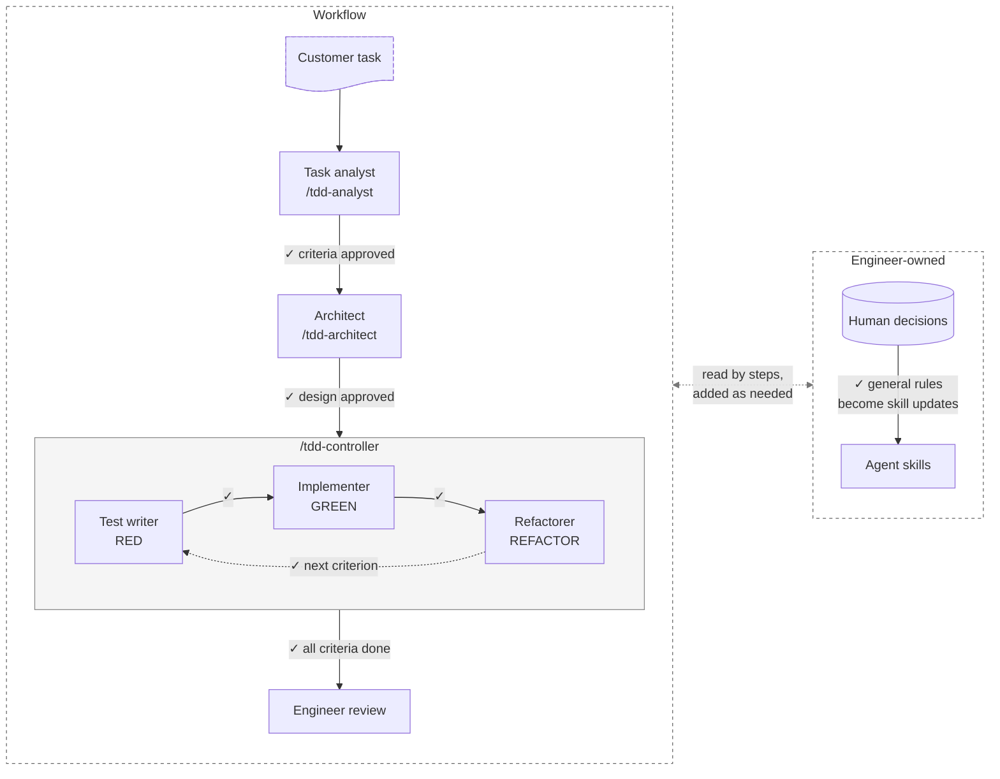

# Agentic TDD

A human-supervised workflow in which Claude Code agents deliver software
using strict test-driven development. Separate agents handle analysis,
design, tests, implementation, and refactoring, and the engineer approves
every decision and every commit.

**Status:** experimental. Pilot 1 is finished; pilot 2 is in progress.

## How it works



✓ marks the engineer's approval: every step ends with it. The analyst and
architect work interactively with the engineer; the three coding agents
each run in their own context, commit their own stage, and stop. The
controller runs one acceptance criterion at a time and checks each commit
before asking for approval.

### The human decision log

The engineer's decisions are the knowledge that shapes everything the
agents do, and they are kept apart from the AI's work: a log entry records
a decision the engineer made, while an agent's recommendation stays a
labeled proposal until the engineer approves it. Every explicit decision is
written down before anything relies on it, in two append-only logs per
pilot: behavior decisions from the analyst (what
the system must do) and engineering decisions from the architect and the
coding agents (how it is built). A changed decision becomes a new entry
that supersedes the old one, so the reasoning stays traceable.

- **Steps read it and add when needed:** the analyst, architect, and
  coding agents start from the existing decisions and ask only about what
  they do not settle. A step that raises no new question adds nothing.
- **It explains the code:** the logs say why the solution and tests look
  the way they do, and the design document links each part of the public
  API to the criteria it serves.
- **It carries over:** a later pilot on the same problem reuses earlier
  decisions as answers instead of asking again.
- **It changes the agents themselves:** a decision that turns out to be a
  general rule is proposed as an update to the agents' skills and rules in
  `.claude/`, and applied in a separate commit only after the engineer
  approves it. Most of the test writer's style rules started as engineer
  decisions in pilot 1.

See pilot 1's logs for an example:
[behavior decisions](pilot/TransactionDeduplicator/pilot1/analyst/behaviour-decisions.md)
and
[engineering decisions](pilot/TransactionDeduplicator/pilot1/engineering/engineering-decisions.md).

## What's in the repo

- [`.claude/skills/`](.claude/skills/): the skills you start by hand:
  `tdd-analyst` (task to acceptance criteria), `tdd-architect` (criteria to
  design, then an empty solution), and `tdd-controller` (runs the coding
  agents). `tdd-common-rules` holds the rules shared by the coding agents.
- [`.claude/agents/`](.claude/agents/): the coding agents `test-writer`
  (RED), `implementer` (GREEN), and `refactorer` (REFACTOR).
- [`pilot/TransactionDeduplicator/`](pilot/TransactionDeduplicator/): the
  customer task used for the pilots, and
  [`pilot1/`](pilot/TransactionDeduplicator/pilot1/) with its acceptance
  criteria, decision logs, design, and the C# solution with its tests.
  `pilot2/` follows as pilot 2 progresses.
- [`docs/MANIFEST.md`](docs/MANIFEST.md): the project manifest.

## Try it

You need [Claude Code](https://claude.com/claude-code); the pilot code also
needs the .NET 10 SDK.

1. Open the repository in Claude Code.
2. `/tdd-analyst <task file>`: answer its questions; it writes the
   acceptance criteria and a behavior decision log.
3. `/tdd-architect <criteria file>`: decide the design with it; after you
   approve, it scaffolds the empty solution.
4. `/tdd-controller`: it runs each criterion through RED, GREEN, and
   REFACTOR and stops for your approval after every commit.

To run pilot 1's tests:

```bash
dotnet test pilot/TransactionDeduplicator/pilot1/TransactionDeduplicatorPilot1.sln
```

## Pilot 1 results

Pilot 1 built the TransactionDeduplicator task with a single coding agent,
before the work was split into separate agents.

- **The full RED → GREEN → REFACTOR cycle worked:** 10 behaviors in 29
  commits over 3 days: 10 RED, 10 GREEN, and 9 REFACTOR (two behaviors
  needed no refactoring, one needed two). Example:
  [RED](https://github.com/michal-pekala/AgenticTDD/commit/db8ff454230acba993caabdc50fbfae5d41b63dc)
  →
  [GREEN](https://github.com/michal-pekala/AgenticTDD/commit/e2947562efee16860311b260e5bc929b04594139)
  →
  [REFACTOR](https://github.com/michal-pekala/AgenticTDD/commit/32f3e656fe13e2bb8232aa92693359962ff86fdf)
  for "duplicate attempt refreshes expiration".
- **The agent built ahead of the tests:** the engineer had to add decisions
  to keep GREEN minimal (C-023), defer synchronization and expiry refresh
  (C-040, C-041), and implement designed behavior only when a test requires
  it (C-042). One refactor
  ([1aff6e8](https://github.com/michal-pekala/AgenticTDD/commit/1aff6e834ddb59ded029179386c4760626ab8e8c))
  removed a speculative lock-free retry loop that no test needed. This is
  now a shared rule for all coding agents.
- **Test style needed the most correction:** 19 of the 44 engineering
  decisions are test-style rules (expression-bodied tests, randomized
  inputs, full-message assertions from shared templates, shared fixtures).
  They are now part of the test writer agent.
- **The analyst put a technical choice into the criteria:** an exception
  type in the capacity criterion, corrected by decision D-012 and
  [5b63e24](https://github.com/michal-pekala/AgenticTDD/commit/5b63e244d2a2a5d286e4962b5baaaed56dfcd002).
  Technical choices now belong to a separate architect role.

## Design principles

See [docs/MANIFEST.md](docs/MANIFEST.md).
